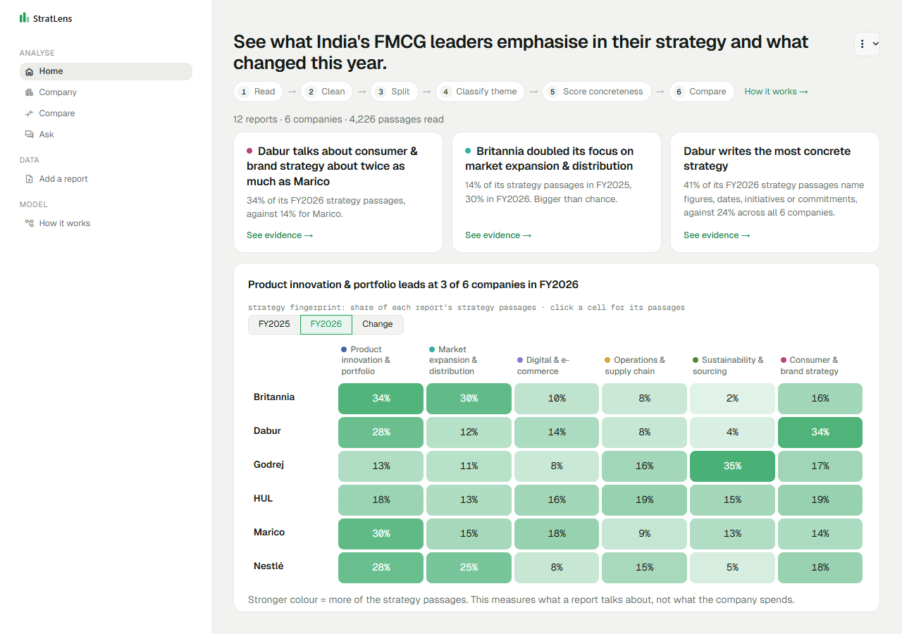
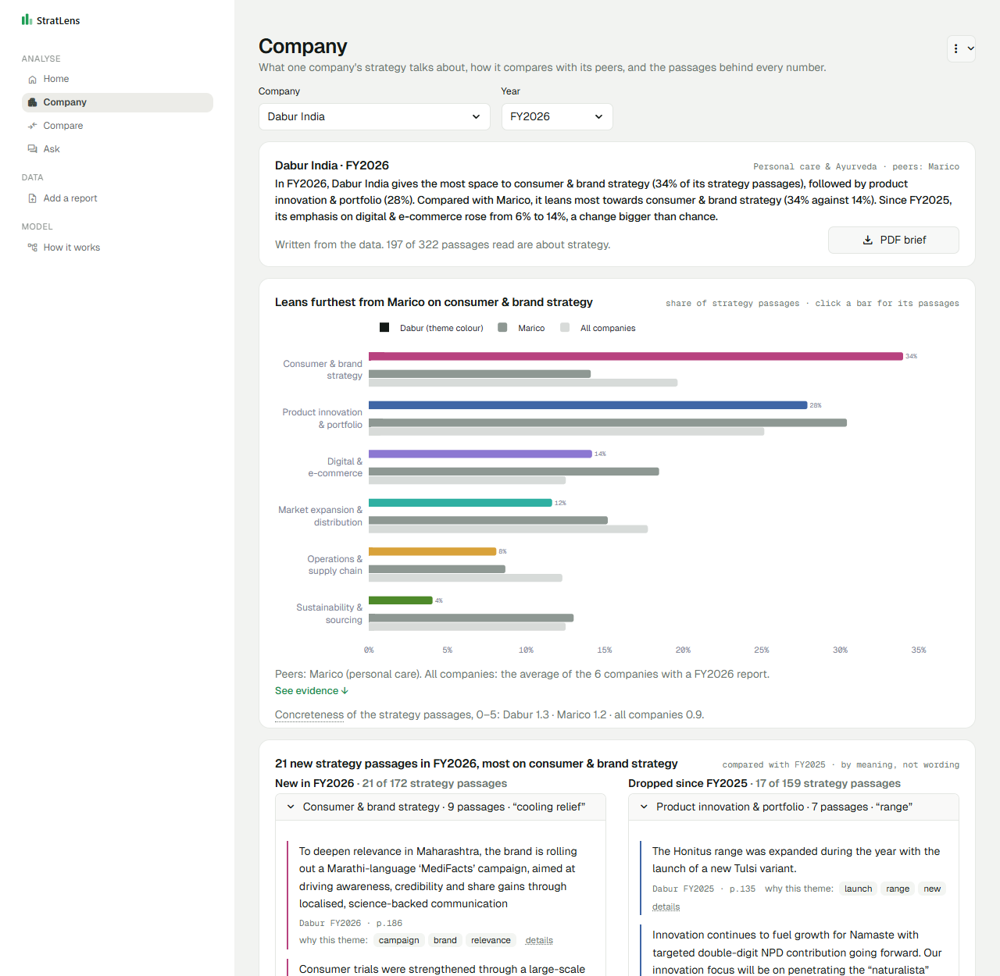

# StratLens

**See what India's FMCG leaders emphasise in their strategy and what changed this year.**

Annual reports run to 200–600 pages and the strategy story is buried in about 20 of them. StratLens reads only the Chairman's letter and the MD&A of 12 reports (Dabur, Marico, Hindustan Unilever, Godrej Consumer Products, Nestlé India and Britannia; FY2025 and FY2026). It sorts every passage into six strategy themes with a trained text classifier and scores how concrete each passage is. It then shows, in plain English, where each company leans compared with its peers, which shifts are bigger than chance, and the exact passages behind every number. An LLM writes sentences and cited answers. It never labels passages or computes a number.



## How it works

**Read → Clean → Split → Classify theme → Score concreteness → Compare**

| Step | NLP technique |
|---|---|
| Read | Text extraction with page numbers (PyMuPDF); Chairman/CEO letter and MD&A only |
| Clean | Regular expressions: running headers, page numbers, tables and legal boilerplate removed |
| Split | Sentence segmentation and tokenisation into 8–70 word passages |
| Classify theme | Company, brand, number and year masking → TF-IDF on words and word pairs → logistic regression (6 themes + Other) |
| Score concreteness | spaCy named entity recognition + regex: figures, dates, named initiatives, commitments (0–5) |
| Compare | Theme shares per report; a difference counts only if its 95% bootstrap interval excludes zero |
| What's new / promises | MiniLM sentence embeddings (meaning matching) + spaCy DATE/PERCENT/MONEY entities |
| Ask | Retrieval (BM25 + MiniLM, rank fusion) → Gemini writes an answer that cites the passages |

Everything is computed offline by one command; the app only reads the results, so pages load in about a second and the demo works without internet.

## What the app shows

| Page | What you get |
|---|---|
| **Home** | Three findings (the biggest lean against peers, the biggest real year-on-year shift, the most concrete company) and a clickable fingerprint of 6 companies × 6 themes |
| **Company** | A 3-sentence brief (PDF), benchmark against peers and all companies, what's new and what was dropped this year, measurable promises and whether they were mentioned again, signature phrases, and the evidence behind every theme |
| **Compare** | Any two reports: which theme differences are real and which are noise, topics found in only one report, concreteness by theme |
| **Ask** | A question in plain English → passages → a cited answer |
| **Add a report** | Run another annual report through the same pipeline and see it next to the six |
| **How it works** | The step-by-step pipeline inspector, accuracy, and limits |

⋮ → **Demo mode** (or open `?demo=1`) walks Home → Company → Compare → Ask → How it works with a Next button.



## Results

12 reports → 4,226 passages → 1,687 about strategy. The classifier was trained on 708 labelled passages from Dabur, HUL and Nestlé India and tested on 177 it never saw:

| Model (same 177 test passages) | Macro-F1 | 95% CI |
|---|---|---|
| **Word-weight classifier (TF-IDF + logistic regression)**, used | **0.77** | 0.69–0.84 |
| Meaning-based classifier (MiniLM embeddings) | 0.77 | 0.69–0.83 |
| Keyword matching | 0.49 | 0.41–0.55 |

The two classifiers tie, so the app uses the one whose every decision can be traced to words. Marico, Britannia and Godrej were never in training, so they are an honest test of generalisation: `python -m stratlens.audit` scores the model on 90 hand-labelled passages from them (see Limits).

## Quick start

Python 3.11+.

```bash
pip install -r requirements.txt     # CPU-only PyTorch; includes the spaCy model
streamlit run app.py
```

Processed data and the trained model are in the repository, so the app runs without the PDFs. The first run downloads the MiniLM model (~90 MB); after that the app works offline.

**Optional AI writing:** copy `.env.example` to `.env` and set `GEMINI_API_KEY`. Without a key, or offline, every page works: the text is written from the data by templates, and Ask shows the passages without a written answer. AI outputs are cached on disk, so anything generated once works offline afterwards.

## Add a report

```bash
# 1. save it as data/raw/{company}_FY{yyyy}.pdf, e.g. britannia_FY2027.pdf
python -m stratlens.build            # 2. extract, classify, score, compare (skips unchanged reports)
streamlit run app.py                 # 3. it appears on every page
```

The build prints the pages it kept for the letter and the MD&A. If it cannot find them reliably it skips the report with a warning; add the page ranges to `config/section_overrides.csv` and run it again. A new company needs a line in `config/companies.yaml` (name, peer group) and its brands in `config/gazetteer.yaml`. For a one-off look without building, use **Add a report** in the app.

## Data sources

Statutory annual reports filed with the National Stock Exchange of India; every file and URL is listed in [docs/data_sources.md](docs/data_sources.md). The PDFs are not in the repository. Report-specific choices: Britannia publishes no Chairman/CEO letter, and Godrej's MD&A is its whole integrated report (the TCFD climate section is excluded).

## Limits

- **Emphasis, not spending.** A theme's share is how much of the strategy text talks about it. It is not money spent, execution or a ranking.
- **Writing style leaks.** Even with names, brands and numbers hidden, a classifier guesses the company 79% of the time (chance 49%), so some differences between companies may be house style.
- **Weaker on some companies.** On the original test set, Nestlé India scores macro-F1 0.44 on only 25 passages, against about 0.8 for Dabur and HUL. Marico, Britannia and Godrej were never in training and the model is less confident on them (20–47% of their passages are flagged as low confidence, against 8–11% for the others). The Company page warns when this applies.
- **Labels are partly AI-drafted.** The 885 training labels were drafted by an AI assistant following [written guidelines](docs/labelling_guidelines.md). A hand-labelled check of 190 passages (`data/labels/verify_*.csv`, scored by `python -m stratlens.audit`) measures how far they can be trusted.
- **Only the letter and the MD&A are read.** Sustainability reports and notes to the accounts are ignored, and Godrej's integrated MD&A makes its sustainability share not like-for-like.
- **Bag of words.** Negation, tense and intent are invisible to word counts. Concreteness is rule-based (48 of 60 spot-checked tiers agreed). Promises need an explicit figure plus a deadline or commitment, so they are rare: four reports have none.

## Repository

```
app.py, views/        Streamlit app (one file per page)
stratlens/            pipeline and analysis: build, extract, sections, preprocess, masking, model, specificity,
                      analytics, features (what's new, promises, signature phrases), insights, llm/ (Gemini, retrieval)
config/               companies, themes, gazetteer, app copy and presets, section page ranges
train.py              training and evaluation (reports/metrics.json, MODEL_CARD.md)
data/                 processed passages, analytics, embeddings, caches, labels (raw PDFs git-ignored)
docs/                 data sources, demo script, labelling guidelines, write-up, pitch
archive/v1/           results of the first version, kept for comparison
tests/                pytest suite
```

More: [model card](MODEL_CARD.md) · [demo script](docs/demo_script.md) · [write-up](docs/writeup.md) · [pitch](docs/pitch.md)
