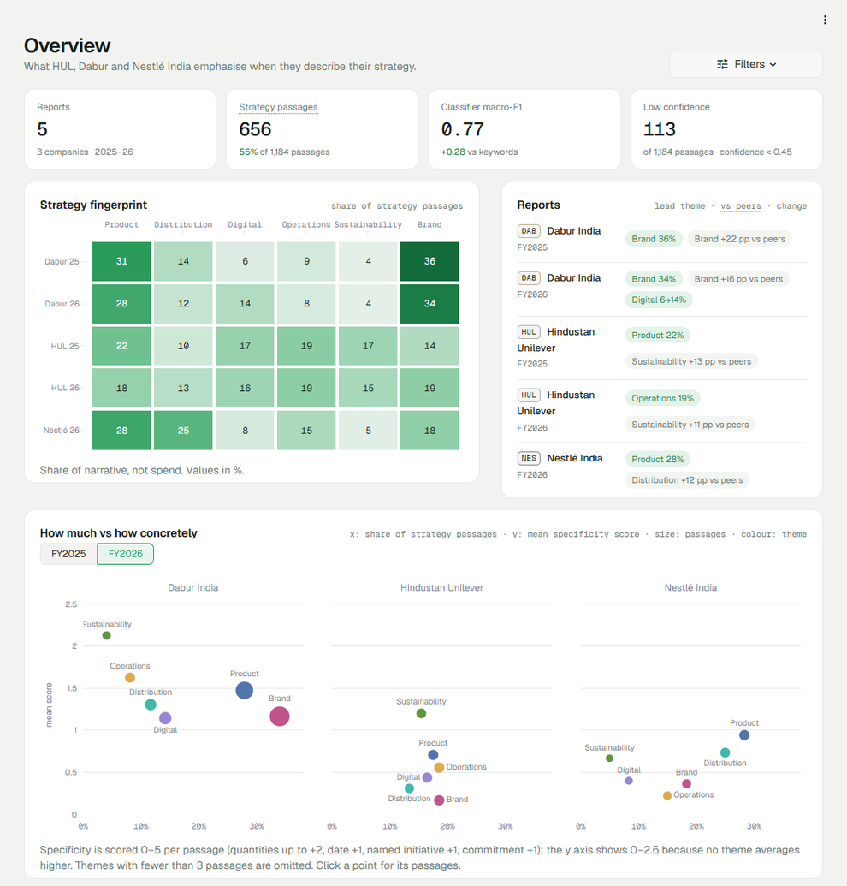
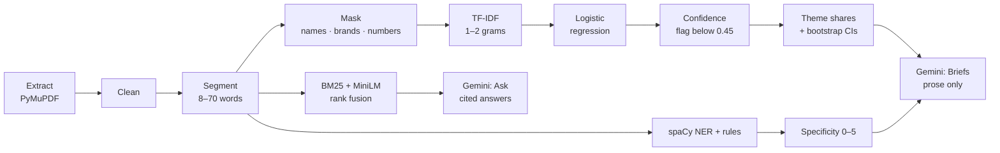
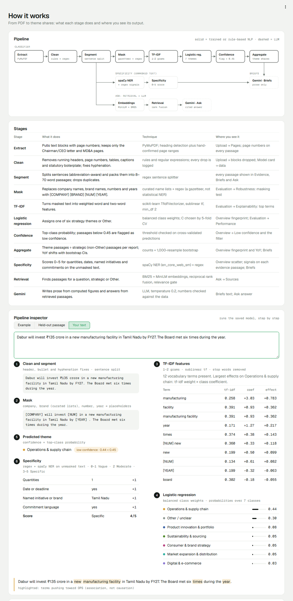
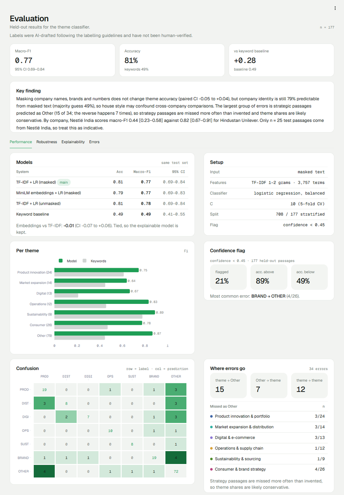

# StratLens

**What do Indian FMCG companies emphasise when they describe their strategy, and how concretely?**

StratLens reads the Chairman/CEO letter and MD&A of annual reports, classifies every passage into one of six strategy themes (or Other), and compares each company's **share of narrative** per theme across companies and years. Every number links back to the passages behind it.



> Shares measure disclosure emphasis, not spending, execution or results.

## Results

5 reports (HUL FY25–26, Dabur FY25–26, Nestlé India FY26) → 1,184 passages → 885 labelled (708 train / 177 held-out test).

| Model (same held-out test set) | Accuracy | Macro-F1 | 95% CI |
|---|---|---|---|
| **TF-IDF + logistic regression, masked** (served) | 0.81 | **0.77** | 0.69–0.84 |
| MiniLM embeddings + logistic regression, masked | 0.79 | 0.77 | 0.69–0.83 |
| TF-IDF + logistic regression, unmasked | 0.81 | 0.78 | 0.69–0.84 |
| Keyword baseline | 0.49 | 0.49 | 0.41–0.55 |

Embeddings tie with TF-IDF (paired difference −0.01, CI −0.07 to +0.06), so the model that can be explained term by term is served.

**Audit findings**
- **House style:** masking names, brands and numbers doesn't change theme accuracy, but the company is still **79%** identifiable from masked text (chance 49%). Cross-company differences may partly reflect writing style.
- **Error direction:** the largest group of errors (15 of 34) is strategy passages predicted as Other; the reverse happens 7 times. Theme shares are likely conservative.
- **Nestlé India** scores lower (macro-F1 0.44 vs 0.82 for HUL), but on only n = 25 test passages, so this is indicative.

**Finding:** the only year-over-year shift that clears bootstrap noise is Dabur's digital & e-commerce share, 6% → 14%.

## How it works



The classifier produces every label and number. The optional LLM (Gemini) only writes prose from computed figures and answers questions from retrieved passages; numbers it writes are checked against the data, and it refuses when nothing relevant is retrieved. The app's **How it works** page has an inspector that runs any sentence through each step.



## Quick start

Python 3.11+.

```bash
pip install -r requirements.txt     # CPU-only torch; includes the spaCy model
streamlit run app.py
```

Trained artefacts are committed, so the app runs without retraining or the source PDFs. The first run downloads `all-MiniLM-L6-v2` (~90 MB).

**Optional AI writing:** copy `.env.example` to `.env` and set `GEMINI_API_KEY` (optional `GEMINI_MODEL`, default `gemini-3.5-flash`). Without a key, everything works with template text.

## App

| Section | Page | What it shows |
|---|---|---|
| Analysis | Overview | Strategy fingerprint, per-report summary, how much vs how concretely, YoY shifts with 95% CIs, evidence passages |
| | Briefs | One-page brief per report or a 2–3 company comparison; HTML/PDF export |
| | Ask | Question → hybrid retrieval over all passages → cited answer |
| Data | Upload | Classify a new report (PDF/TXT) and add it to the Overview |
| Model | How it works | Pipeline diagram, stage table, step-by-step inspector |
| | Evaluation | Model comparison, robustness (subgroups, masking, author probe, cross-year), explainability, errors |
| | Model card | Generated `MODEL_CARD.md` |



## Reproduce

Put the reports in `data/raw/` as `COMPANY_FYyyyy.pdf` (not in the repo; page ranges are in `config/section_overrides.csv`), then:

```bash
python scripts/build_corpus.py   # extract → clean → segment → data/processed/corpus.csv
python train.py                  # tune, compare, audit → models/, reports/metrics.json, MODEL_CARD.md
python -m pytest -q              # 58 tests
```

## Repository

```
app.py, views/        Streamlit app (one file per page)
stratlens/            pipeline: extract, preprocess, masking, model, explain, audit, uncertainty,
                      specificity, compare, report, trace; llm/ (Gemini client, prompts, retrieval)
train.py, scripts/    training, corpus build, labelling, benchmark, model card
data/                 corpus, labels, splits, predictions, caches (raw PDFs git-ignored)
models/, reports/     trained classifier, metrics.json, error analysis
docs/                 write-up, pitch, labelling guidelines, specificity spot-check
tests/                pytest suite
```

## Limitations

- **Labels** were AI-drafted following [`docs/labelling_guidelines.md`](docs/labelling_guidelines.md) and have **not been human-verified**. Scores measure agreement with those drafts.
- **Small data:** 5 reports, 3 companies, 9–79 test passages per theme; Nestlé has one year only.
- **Bag of words** misses negation, tense and intent.
- **Specificity** is rule-based (48/60 tiers agreed in two spot-checks) and favours brand-by-brand writing.

More: [model card](MODEL_CARD.md) · [write-up](docs/writeup.md) · [pitch](docs/pitch.md)
